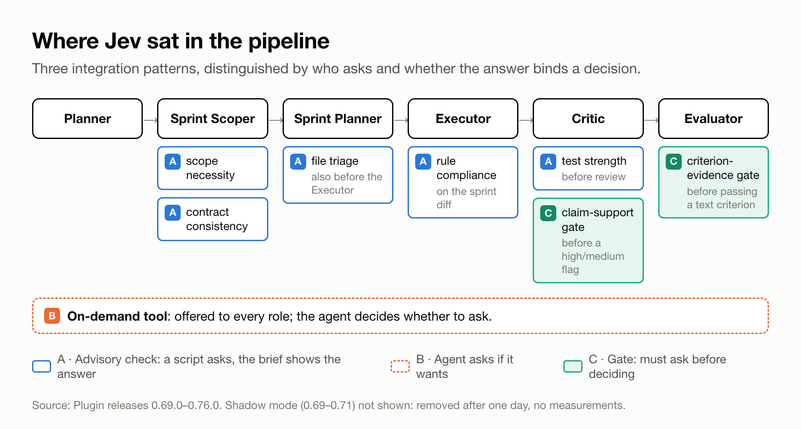
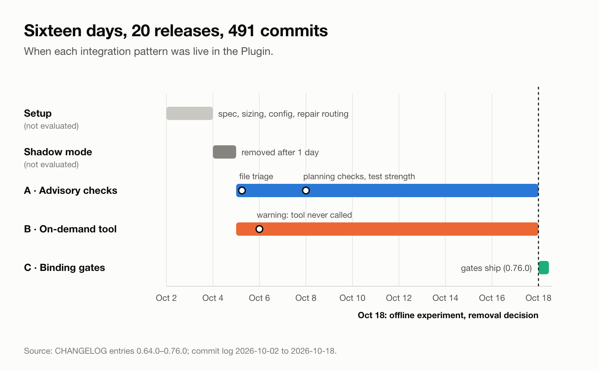
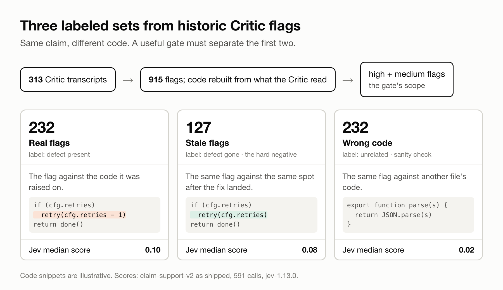
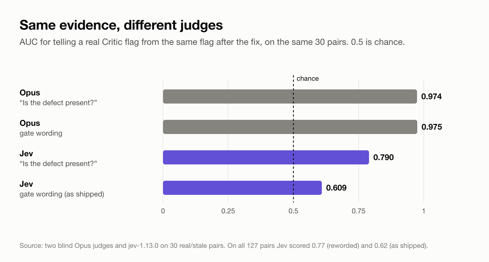
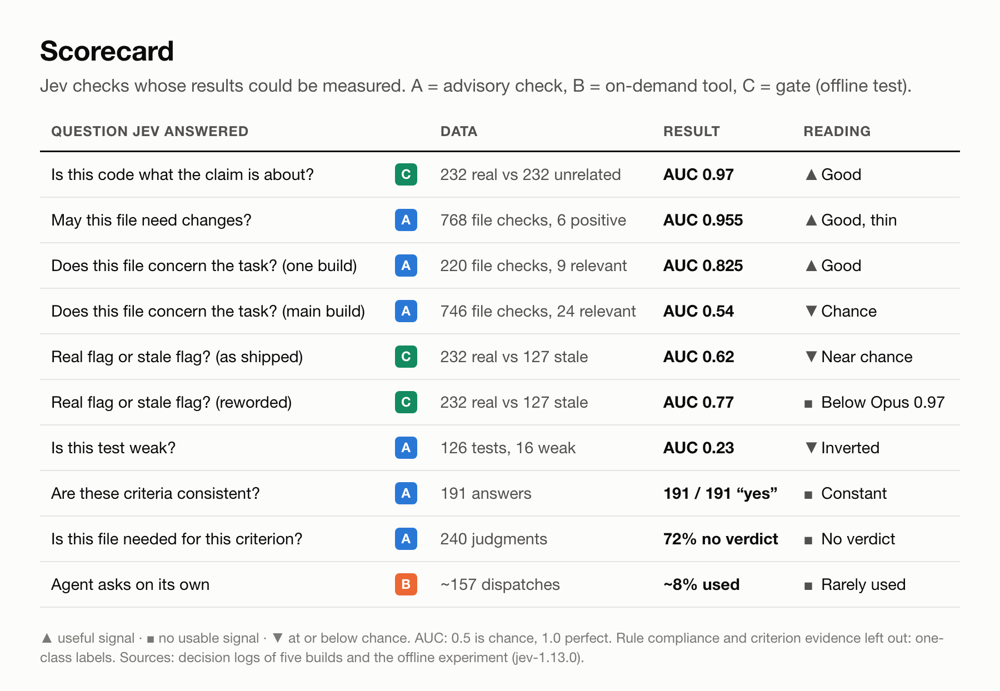
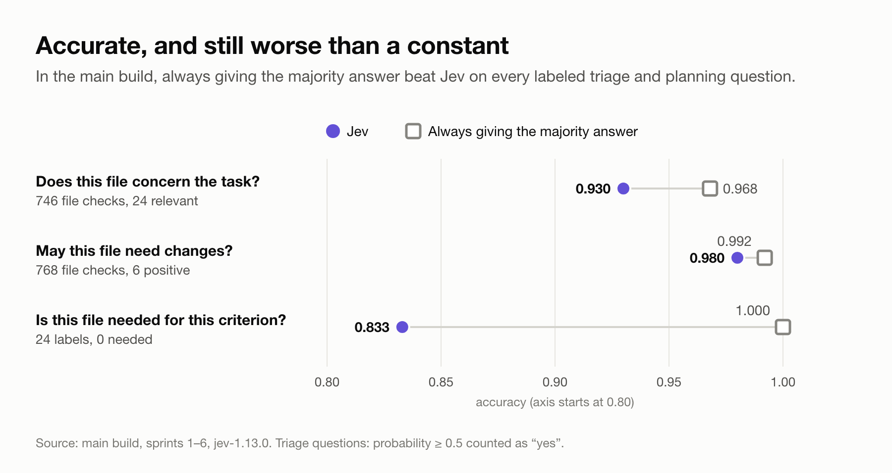

# Accurate and Useless: What 5,300 Calls to a Small Judge Model Taught Us

*We gave a fast, cheap judgment model three jobs in a multi-agent coding pipeline. It was right almost every time, and agents rarely acted on it.*

---

## TL;DR

- Over 16 days in October 2026 we put [Jev](https://typesafe.ai), TypeSafe's small judgment model, into our Plugin, a multi-agent build pipeline for Claude Code. The goal was to save agent tokens without making results worse. We tried and measured three integration patterns: automatic advisory checks, an on-demand tool for agents, and binding gates.
- Jev answered 4,222 calls across five real builds. An offline experiment added 1,092 more.
- Its high accuracy came mostly from agreeing with the majority answer. Where the answer was open, results were mixed. They ranged from chance (AUC 0.54 and 0.62) to good (0.825, and 0.955 on only 6 positives), with one inverted ranking on a proxy label (0.23).
- Our measurement failed first. Most label sets had a single class, so they could not show value whatever Jev did. We never measured the token savings we were after, because no check first showed that Jev judged reliably.
- It reliably noticed when code had nothing to do with a claim (AUC 0.97).
- We removed it and kept the scripts that test it offline.
- The anonymized data, the figures and a script that recomputes every number in this article are on GitHub: [sash-ua/jev-experiments](https://github.com/sash-ua/jev-experiments).

---

## The idea

The Plugin builds features in Claude Code through a chain of agents. A Planner writes the spec, and a Sprint Scoper splits it into sprints with acceptance criteria. For each sprint, a Sprint Planner plans the work, an Executor implements it, a Critic reviews the diff, and an Evaluator checks the criteria. The agents are Opus- and Sonnet-class models.

Jev is one of the [System One](https://docs.typesafe.ai/concepts/how-to-build-with-system-one) models from [TypeSafe](https://typesafe.ai). It answers bounded questions with typed outputs: a choice, a score, or the probability that a statement is true. Median input per call ranged from about 1.5k tokens (claim support) to 26k (contract consistency), and median latency from 250 to 500 ms.

The goal was token economy without making results worse. We wanted to hand small, bounded judgments to a cheap model, so the large agents would spend fewer tokens on them. Typical questions were "is this file relevant to the task?" and "do these lines support this claim?"

*Figure 1. Where Jev sat in the pipeline, by integration pattern.*

*Figure 2. Sixteen days: 20 releases, 491 commits.*

Between 2 and 18 October, 20 releases and 491 commits touched Jev. Two early pieces aren't evaluated here. A shadow mode, which recorded Jev's answers without using them, lasted one day and left no measurements. Repair routing, the first check we shipped, ran only 17 times across five builds, too few to judge.

---

## How we measured

The pipeline recorded every call with its request and answer. After each sprint it labeled the answers against what happened next: was the file later edited or read, did the Critic flag that test, did the criterion pass. A report scored each check and recommended keeping or removing it.

In file triage about 96% of files were irrelevant, so a model that always answers "irrelevant" scores 96%. That is why we report AUC (0.5 is chance, 1.0 is perfect separation) or compare Jev with always giving the majority answer.

A token saving only counts if the result doesn't get worse, so each check first had to show that Jev judged reliably. None got that far, so we never measured agent-token savings and report the judging side instead.

---

## Terms

- **Abstain / uncertain.** Jev's score lands between the two cut-offs, so it gives no verdict.
- **Insufficient evidence.** An answer Jev can choose: the input can't settle the question. Like an abstention, it gives no verdict.
- **Majority answer.** The answer a check's labels show most often, such as "irrelevant" in file triage. Always giving it scores that answer's share: 96% in file triage.
- **AUC (area under the ROC curve).** Take one random positive case and one random negative case: how often does the model score the positive one higher? 0.5 is a coin flip, 1.0 is perfect, and below 0.5 the ranking is backwards. Unlike accuracy, it can't be inflated by always giving the majority answer.
- **Balanced accuracy.** Accuracy measured on each class separately, then averaged. Always giving the majority answer scores 0.5.
- **Brief.** The context document the pipeline assembles for an agent before it starts work.
- **Critic flag.** A defect the Critic reports in the diff, rated high, medium or low.
- **Dispatch.** One run of one agent on one task.
- **Gate.** A point where an agent must ask Jev before it decides.
- **Label.** What actually happened later, used as the right answer: the file was edited, the flag was fixed, the criterion passed.
- **Positive (minority class).** The rare case a check exists to find: a relevant file, a weak test, a defect still present.
- **Template.** A fixed question format Jev answers, such as file triage or claim support.
- **Threshold.** The score at which an answer turns into an action, such as 0.7 for "may need changes" or 0.8 for "supported".
- **Top-k.** Taking the k highest-scoring items instead of everything above a threshold.

---

## The experiments

### A. Automatic advisory checks

**Why this way.** Scripts ask Jev at fixed points in the pipeline and add the answers to the agent's brief, so no agent has to remember to ask.

**Goal.** Cut wasted reading and catch planning mistakes early.

**What we ran and what came back:**

- **File triage**, before sprint planning and implementation. Jev scored each file outside the sprint's planned write set on three questions: does it concern the task, may it need changes, does it define a constraint. In the main build that meant 2,304 judgments over 768 file checks (one file, judged for one sprint).
  - *Concerns the task:* AUC 0.54. In 24 checks an agent later edited or read the file (18 distinct files), and triage dropped 21 of them.
  - *May need changes:* AUC 0.955, the best signal we saw, but on only 6 positives (5 distinct files). Every positive scored 0.31–0.53, under the 0.7 routing threshold. One file was routed, and it was the wrong one.
  - *Defines a constraint:* this route produced 32 of the 39 files that reached agent briefs, and no label measured it.
  - In another build, relevance reached AUC 0.825 (9 relevant out of 220 file checks). In a third, 801 labels contained zero relevant files.
- **Scope necessity**, at sprint scoping. 172 of 240 judgments (72%) gave no usable verdict: 154 uncertain and 18 insufficient evidence. Many had near-uniform probabilities such as 0.34 / 0.33 / 0.33.
- **Contract consistency**, at sprint scoping. 191 of 191 answers were "consistent", median confidence 0.98. The one real contradiction in that build was between a contract and existing code, which the template never saw.
- **Rule compliance** on the sprint diff. 80 labeled answers: 56 compliant, 24 insufficient evidence, and zero violations to find.
- **Criterion evidence**, before the Evaluator passes a text-only criterion (advisory first, a gate from 0.76.0). Every label was "met" (32, 27 and 5 in three builds), so there was nothing to detect. In the main build the pipeline skipped 17 of 18 Evaluator gates because a command had already verified the criterion. All 9 answers were "insufficient evidence".
- **Test strength**, before the Critic. Inversely ranked against later Critic flags: AUC 0.23. Jev's weak-vs-held accuracy was 0.49 (62 of 126 tests), against 0.87 for always giving the majority answer, "held" (110 of 126). The label is a proxy, though: a test counts as weak when a Critic flag lands inside its hunk, and a flagged hunk may be a larger one.

**Verdict.** Accurate where the majority answer was enough, uninformative where it wasn't. The four labeled builds recorded 0, 2, 39 and 10 answers that agents acted on.

**Could be improved** (suggestions, not tested):
- Use the "may need changes" score as a top-k ranking instead of a fixed cut-off. The fixed threshold discarded its one good ranking.
- Let consistency checks see the code a contract touches. The only real contradiction was with code.

### B. An on-demand tool for agents

**Why this way.** The assumption was that agents know best when they are unsure. We gave every role a tool with templates for common questions and a free-form "ask" template.

**Goal.** Have Jev answer the questions agents have, when they have them.

**What happened.** Agents mostly didn't ask. On 6 October we added a warning for sprints where the tool was offered and never called. In the main build it was offered in about 157 dispatches and used in about 8% of them. When Critics did ask whether the cited code supported their own flags (27 times in one build), 26 answers came back "uncertain". None reached the 0.8 "supported" bar.

**Verdict.** Too little use to help, and the questions Critics asked never cleared the bar.

### C. Binding gates, and the offline test that settled it

**Why this way.** A and B both left Jev's answer optional. The 0.76.0 gates bound it to a decision. Before raising a high or medium flag, the Critic must ask whether the cited lines support the claim. Before passing a text-only criterion, the Evaluator must ask whether the evidence meets it.

**Goal.** Filter out false Critic flags without blocking real ones.

The gates shipped on the day we decided to remove Jev and saw one sprint of real use, with three answered gates. So we tested the Critic gate offline.

**Method.** We rebuilt 915 Critic flags from 313 Critic transcripts. For each one we recovered the code the Critic itself had read, which gave the flagged line with 25 lines of context for 721 of them. From the high and medium flags we built three labeled sets:

- **Real flags** (232): the flag against the code it was raised on.
- **Stale flags** (127): the same flag against the same spot after the fix landed. The defect is gone; the claim is unchanged.
- **Wrong code** (232): the flag against another file's code, as a sanity check.

*Figure 3. Three labeled sets from the same historic flags.*

Jev received the gate's exact request (591 calls), the same request with a wider code window (142 calls), and a plainer question (359 calls). Two blind Opus judges answered both wordings on 30 real/stale pairs, each seeing every claim only once. We set the bar before the run: the gate had to beat always giving the majority answer ("supported") on balanced accuracy without challenging most real flags.

**Result.**

- Jev knows whether code is what a claim is about: real vs wrong code, AUC 0.97.
- It can't tell defective code from fixed code: real vs stale, AUC 0.62, with balanced accuracy 0.51 against 0.50 for always giving the majority answer. A ±150-line window changed nothing.
- As shipped, the gate would have challenged 82% of real flags (94% of high flags) and supported none.
- Rewording the question to "Is the defect this finding describes present in the code shown?" lifted Jev to 0.77.
- On the same 30 pairs, Opus reached 0.97–0.98 with either wording. Jev reached 0.79 reworded and 0.61 as shipped.
- Under the gate's "establishes the exact claim" wording, even Opus never scored a real flag at 0.8 or above. The "supported" verdict was out of reach for any judge.

*Figure 4. Same evidence, different judges: real vs stale flags.*

Even with the better wording, every stale flag caught costs real flags challenged:

| Challenge below | Real flags challenged | Stale flags caught |
|---|---|---|
| 0.30 | 11% | 44% |
| 0.35 | 19% | 54% |
| 0.40 | 28% | 66% |
| 0.50 | 44% | 80% |

**Verdict.** The gate fails the bar. On the 30 pairs we could check, a strong model solved the task from the same excerpt. The evidence was enough; the gap is Jev's capability.

**Could be improved** (suggestion, not tested): the reworded question, which scored AUC 0.77, could order earlier flags for re-checking in Critic verification rounds without ever replacing the Critic. We judged that too thin to justify the integration.

---

## Scorecard

*Figure 5. Where Jev was good and where it wasn't.*

**Good**
- Noticing unrelated code: AUC 0.97 (591 offline calls).
- Ranking which files need changes: AUC 0.955, on 6 positives.
- Triage relevance in one build: AUC 0.825.
- Cost and speed: about 1.5k input tokens and 250 ms per claim-support call.

**Weak**
- Real vs stale Critic flags: AUC 0.62 as shipped.
- Triage relevance in the main build: AUC 0.54.
- Test strength: AUC 0.23, inversely ranked.
- Planning checks: mostly no verdict or a constant answer.

---

## Why it didn't pay off

**1. Accuracy without information.** When the majority answer is right 96% of the time, being "accurate" is free. In the main build, always giving the majority answer beat Jev on all three labeled triage and planning questions. Our own report scored raw accuracy (0.956 for triage, 0.833 for scope necessity) and recommended keeping both.

*Figure 6. Jev vs always giving the majority answer (main build).*

**2. Labels that couldn't answer the question.** Nearly every label set had a single class: no relevant files, no unmet criteria, no rule violations. On those one-class label sets, no result could have shown value, whatever Jev did. Other labels were proxies ("edited" standing in for "relevant"). The test-strength label partly stored Jev's own prediction, so only its weak-vs-held comparison (16 weak, 110 held) is a real measurement.

**3. Advice nobody had to act on.** Brief sections and an optional tool were rarely acted on: 0–39 answers per build, and about 8% tool use. The data can't tell whether agents ignored the advice because it was optional or because they could see it was wrong. For triage, the second is likely: the agents found the files triage dropped. Either way, the gates were the first design that bound an answer to a decision, and they came last.

**4. A weaker judge beside stronger agents.** On the one question where we measured both, Opus judged the same 30 pairs far better than Jev. It scored AUC 0.97 against Jev's 0.79, even with Jev's better wording. Jev was advising agents of that class.

**5. Wording is a model input.** One rewrite moved AUC from 0.62 to 0.77, and one over-strict bar left a gate unable to fire.

---

## If you try this

1. **Evaluate offline first.** Build a small labeled set with both classes. Compare it with always giving the majority answer, using AUC or balanced accuracy, and add a strong-model reference if you can. Our offline analysis and experiment took one day; the live builds had run for two weeks without answering the question.
2. **Refuse a verdict on one-class labels,** and never build a label from the prediction it scores.
3. **Rank, don't threshold.** Take the top-k by score, or set thresholds from labeled data rather than by hand.
4. **Bind the answer to a decision.** Advice that was optional was rarely used.

---

## Caveats

- The stale flags are constructed. Flags that are wrong when raised may look different. The pipeline never recorded a flag as wrong (all 111 re-checks said "valid"), so the real false-flag rate is unknown.
- The real-flag label assumes every flag was real. The pipeline confirmed them and fixers repaired them, but that confirmation came from the same Critic family, not an independent check.
- The experiment fixed the evidence at 25 lines around the flagged line. The live gate lets the Critic choose the range, which may be wider or narrower.
- The Opus comparison covers 30 pairs. The Jev results cover the full sets.
- We tested one Jev model version (jev-1.13.0) on one codebase. Labels are proxies for relevance and test quality.

---

## Data and code

Every number in this article can be recomputed from the anonymized data in [github.com/sash-ua/jev-experiments](https://github.com/sash-ua/jev-experiments): run `node recompute.mjs`.

*Disclaimer: the repository holds an anonymized extract of the experiment logs, and it is the only part of them we publish. The full logs stay private because they contain our pipeline's source code and review text. Anonymizing replaced identifiers (calls, files, builds) with sequential IDs and removed all text; no score, label or count was changed.*
